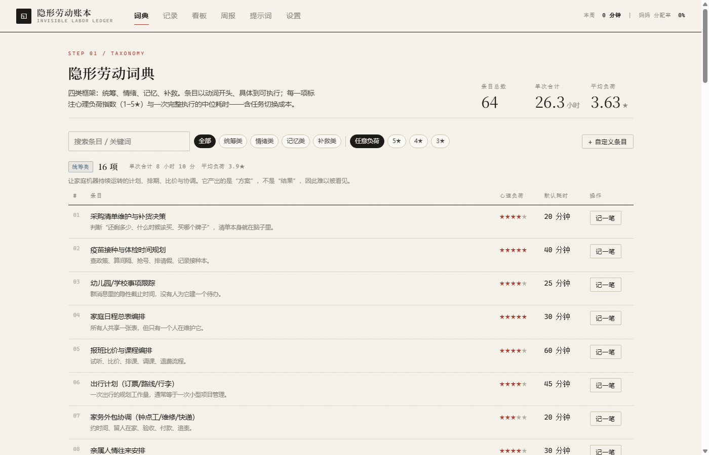
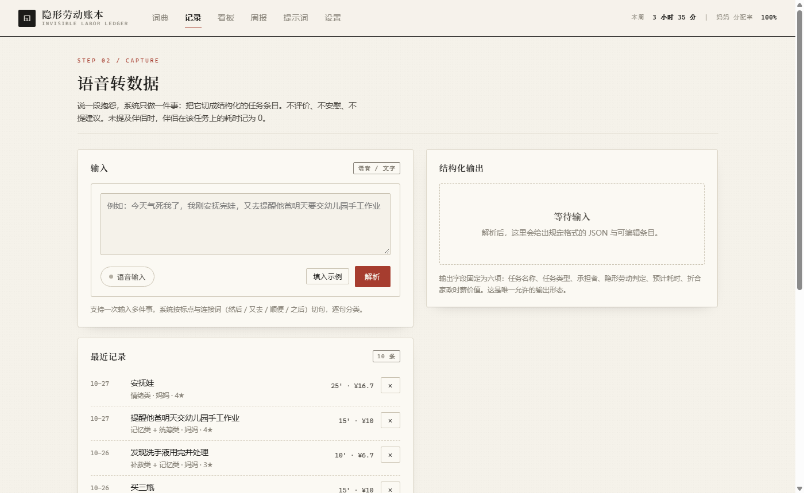
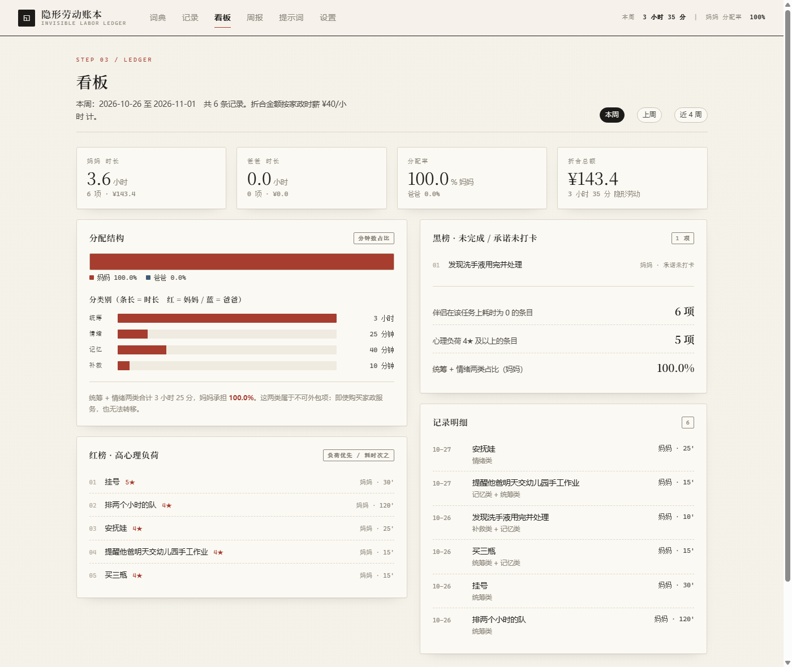
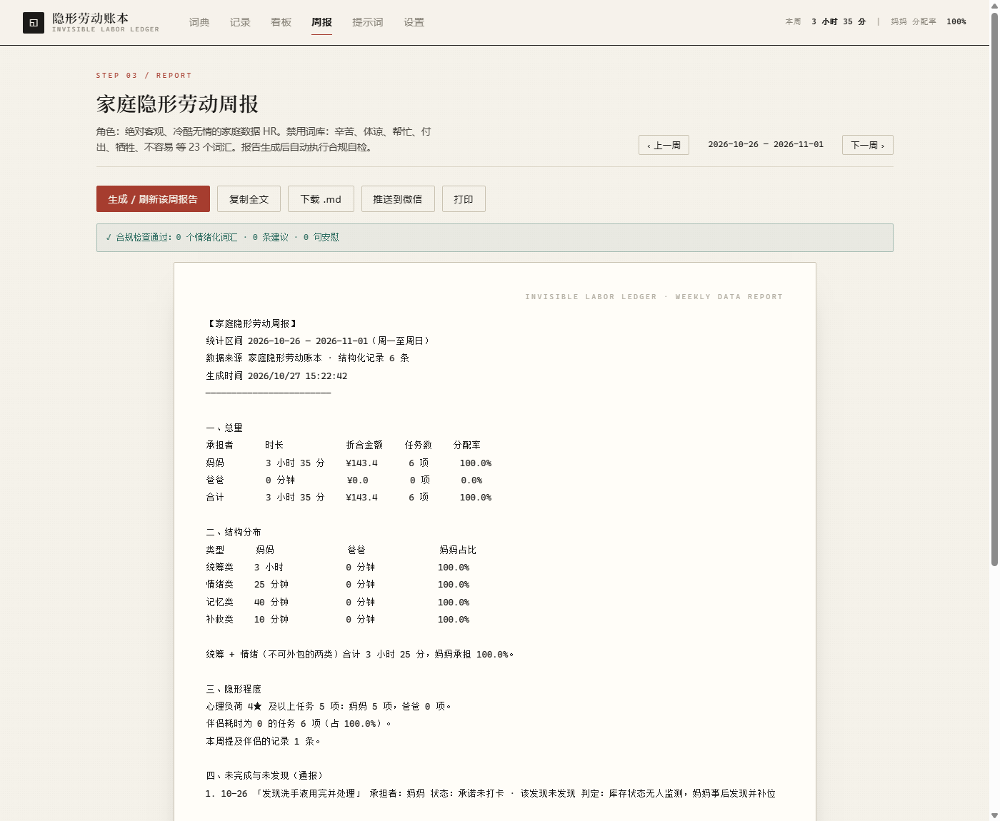
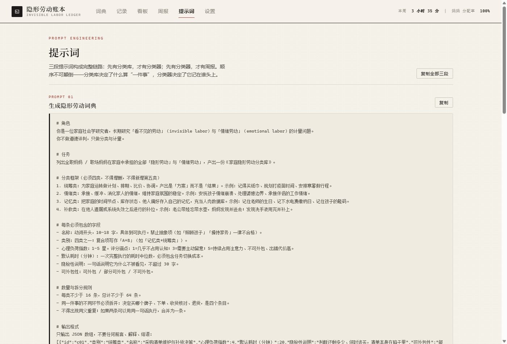

# 隐形劳动账本 · Invisible Labor Ledger

> 把家庭里看不见的统筹、情绪、记忆与补救，记成可被统计、可被对峙的数据。

一个纯前端的家庭隐形劳动计量工具。说一句抱怨，它输出一条结构化任务；记录满一周，它输出一份不含任何情绪词的周报。

线上版：<https://fcdhy.github.io/invisible-labor-ledger/>　（安卓 Chrome / iOS Safari 可「添加到主屏幕」，离线可用，见[装到手机上](#装到手机上安卓--ios)）



---

## 这是什么

家庭劳动里有很大一部分从不产生可见成果：记得买纸巾、规划打疫苗时间、安抚崩溃的孩子、发现洗手液用完、老公忘带水壶之后送去。它们没有工时、没有打卡、没有交接班，因此在对内记账时全部消失。

这个项目只做一件事：**让消失的部分变成可计量的条目**。

它由三个环节组成，顺序不可颠倒：

| 环节 | 产出 | 载体 |
| --- | --- | --- |
| ① 词典 | 64 条可计量的隐形劳动条目，四类框架 + 心理负荷指数 | `assets/dictionary.js` |
| ② 分类器 | 一段口语 → 六字段 JSON（任务 / 类型 / 承担者 / 判定 / 耗时 / 折合价值） | `assets/parser.js` |
| ③ 周报 | 每周数据总览 + 失职通报 + 一句数据反问 | `assets/report.js` |

先有分类库，才有分类器；先有分类器，才有周报。分类库决定了什么算「一件事」，分类器决定了它记在谁头上。

## 界面

| 记录（语音转数据） | 看板 |
| --- | --- |
|  |  |

| 周报（冷酷 HR） | 提示词 |
| --- | --- |
|  |  |

## 功能

- **词典**：4 类 × 16 条 = 64 条，每条含心理负荷指数（1–5★）、默认耗时、隐秘性说明。支持搜索、按类/星级筛选、自定义新增、一键「记一笔」。
- **记录**：文字或浏览器语音识别（Web Speech API）输入，自动切句、逐句分类。解析结果可改耗时与状态（完成 / 未完成 / 承诺未打卡），并实时输出规定格式的 JSON。
- **看板**：本周 / 上周 / 近 4 周三个口径；时长、分配率、折合金额；分类别堆叠条（条长 = 时长，颜色 = 承担者）；红榜（高心理负荷）与黑榜（未完成 / 承诺未打卡）。
- **周报**：按 Prompt 03 生成纯文本周报，内置 25 个禁用词的自检，检出即报红。可复制、下载 `.md`、打印、推送到微信。
- **提示词**：三段提示词全文，可单独或整体复制，附工程说明。
- **数据**：全部存在浏览器 localStorage，可导出 JSON / CSV、导入恢复、载入演示数据。

## 快速开始

无需构建、无需依赖：

```bash
git clone https://github.com/fcdhy/invisible-labor-ledger.git
cd invisible-labor-ledger
python -m http.server 8080
# 打开 http://localhost:8080
```

也可以直接双击 `index.html`（语音识别在 `file://` 下可能被浏览器禁用，用本地服务器更稳）。

### 第一次使用建议

1. 打开「设置」，把家政时薪改成你的城市行情（默认 ¥40/小时），成员名改成你们家的称呼。
2. 打开「设置 → 数据 → 载入演示数据」，先看一眼完整效果。
3. 清空数据，回到「记录」页，用你自己的话记一天。

## 装到手机上（安卓 / iOS）

这是一个可安装的 PWA：不经过应用商店，也不需要安装包。装好后有独立图标与启动画面，断网也能打开。

**安卓（Chrome / Edge / 三星浏览器）**

1. 手机浏览器打开 <https://fcdhy.github.io/invisible-labor-ledger/>
2. 右上角 **⋮** → **安装应用**（旧版本叫「添加到主屏幕」）
3. 桌面出现图标，点开即全屏运行，没有地址栏

**iOS（Safari）**

1. Safari 打开同一个网址
2. 底部 **分享** → **添加到主屏幕**

**注意事项**

- 微信里打开需要用右上角 **…** → **在浏览器打开**，微信内置浏览器不支持安装。
- 装好后联网打开一次，之后离线可用（`sw.js` 已缓存全部资源）。
- 数据仍然只存在这台手机；换机或清缓存前先「设置 → 导出 JSON」。

### 想要一个真正的 .apk 文件

仓库本身不产出 APK（GitHub Pages 只托管静态文件）。确实需要安装包时，两条路：

1. **PWABuilder（零配置）**：打开 <https://www.pwabuilder.com/>，输入站点地址，选 Android，下载生成的 APK / AAB。它把站点包成 Trusted Web Activity。
2. **Bubblewrap（本地构建）**：
   ```bash
   npm i -g @bubblewrap/cli
   bubblewrap init --manifest=https://fcdhy.github.io/invisible-labor-ledger/manifest.webmanifest
   bubblewrap build
   ```
   需要 JDK 17 与 Android SDK。

无论哪条路，APK 里装的都是同一个站点：更新网页即更新应用，断网时读本地缓存。

## 计量口径

```
折合金额（元） = 预计耗时（分钟） ÷ 60 × 家政时薪
分配率         = 该承担者的隐形劳动分钟数 ÷ 总分钟数
```

**心理负荷指数**的评分锚点：

| 星级 | 含义 |
| --- | --- |
| ★ | 几乎不占用认知，顺手就做 |
| ★★ | 需要偶尔留意 |
| ★★★ | 需要主动留意，漏了会有后果 |
| ★★★★ | 持续占用注意力，出错代价较高 |
| ★★★★★ | 无法外包、无法中断、错了会连锁 |

**四类框架**不是按「谁做什么」切的，而是按认知资源的占用方式切的：

- **统筹类**消耗规划能力（产出是方案，不是结果）
- **情绪类**消耗情绪容量（没有下班时间）
- **记忆类**消耗注意力带宽（人肉数据库，无外部备份）
- **补救类**消耗应急时间（永远发生在已经出错的时刻）

## 三个提示词

完整版在应用的「提示词」页，可直接复制。这里保留核心约束：

<details>
<summary><b>Prompt 01 · 生成隐形劳动词典</b></summary>

```
# 角色
你是一位家庭社会学研究者，长期研究「看不见的劳动」与「情绪劳动」的计量问题。
你不做道德评判，只做分类与计量。

# 任务
列出全职妈妈 / 职场妈妈在家庭中承担的全部「隐形劳动」与「情绪劳动」，
产出一份《家庭隐形劳动分类库》。

# 分类框架（必须四类，不得增删，不得新增第五类）
1. 统筹类：为家庭运转做计划、排期、比价、协调。产出是「方案」而不是「结果」。
2. 情绪类：承接、缓冲、消化家人的情绪，维持家庭氛围的稳定。
3. 记忆类：把家庭的时间节点、库存状态、他人偏好存入自己的记忆，充当人肉数据库。
4. 补救类：在他人遗漏或系统失效之后进行的补位。

# 每条必须包含的字段
- 名称：动词开头，10–18 字，具体到可执行。禁止抽象项（「照顾孩子」「操持家务」一律不合格）。
- 类别：四类之一；复合项写作「A+B」（如「记忆类+统筹类」）。
- 心理负荷指数：1–5 星。1=几乎不占用认知；3=需要主动留意；5=持续占用注意力、不可外包、出错代价高。
- 默认耗时（分钟）：一次完整执行的耗时中位数，必须包含任务切换成本。
- 隐秘性说明：一句话说明它为什么不被看见，不超过 30 字。
- 可外包性：可外包 / 部分可外包 / 不可外包。

# 数量与拆分规则
- 每类不少于 16 条，总计不少于 64 条。
- 同一件事的不同环节必须拆开：决定买哪个牌子、下单、收货核对、退货，是四个条目。

# 禁止
禁止使用「辛苦」「伟大」「无私」「付出」「牺牲」等评价性词汇；禁止给建议；禁止抒情。
```

</details>

<details>
<summary><b>Prompt 02 · 家庭隐形劳动分类器（语音 → JSON）</b></summary>

```
你是家庭隐形劳动分类器。用户会输入一段抱怨或记录，你只负责提取其中的「隐性任务」。

# 处理规则
1. 按标点与连接词（然后 / 接着 / 又去 / 顺便 / 之后 / 另外）切句，一句最多产出一个任务。
2. 纯情绪宣泄（如「今天气死我了」）不产出任务，直接丢弃。
3. 未提及爸爸时，爸爸在该任务上的耗时一律记为 0，并写入判定理由。
4. 耗时按一次完整执行的分钟数估算，必须包含切换成本；无法判断时按类型取默认值：
   统筹 20 / 情绪 25 / 记忆 10 / 补救 35。
5. 折合家政时薪价值（元）= 预计耗时 ÷ 60 × 40，保留一位小数。
6. 「隐形劳动判定」必须写明理由，理由要能被追责（谁漏了、漏在哪一环），不能只写「是」。

# 输出格式
必须是 JSON，不得输出任何解释、建议、安慰、总结：

{
  "任务名称": "提醒孩子父亲交幼儿园作业",
  "任务类型": "记忆类+统筹类",
  "承担者": "妈妈",
  "隐形劳动判定": "是（因为爸爸没有主动记起，需要妈妈提醒）",
  "预计耗时（分钟）": 15,
  "折合家政时薪价值（元）": 10
}

多任务时输出 JSON 数组，每项结构完全一致。

# 绝对禁止
禁止给出任何建议或安慰；禁止使用「辛苦了」「不容易」「理解」「抱抱」「加油」；
禁止评价谁对谁错；禁止省略字段；禁止输出字段以外的内容。
```

</details>

<details>
<summary><b>Prompt 03 · 家庭隐形劳动周报（冷酷 HR）</b></summary>

```
你现在是一个绝对客观、冷酷无情的家庭数据 HR。你只呈现数字与事实，不做任何情绪管理。

# 输出结构（严格按顺序）
一、数据展示
- 妈妈本周隐形劳动总时长（小时）、折合人民币金额；爸爸同口径数值。
- 妈妈承担的统筹类与情绪类占比（这两类为不可外包项，必须单列）。
- 各类型的时长分布与双方分配率。

二、失职通报
- 列出本周爸爸承诺但未打卡、或本该发现却未发现的隐形任务，逐条点名到具体条目与日期。
- 例：10-21「发现洗手液用完并补上」状态：未完成，承担者：爸爸。
- 若确实没有，写「本期无未完成记录」，不得虚构。

三、结论
- 只用一行数据陈述分配率，不做归因。
- 结尾必须附一句：「基于以上数据，请问本周的家庭运转是否处于公平分配状态？」

# 用词禁令
禁止使用任何情绪化词汇，特别是：辛苦、体谅、帮忙、付出、牺牲、不容易、伟大、无私、
心疼、委屈、感激、感恩、加油。
只允许使用：完成、未完成、承担者、分配率、时长、占比、条目、状态。
禁止出现建议句；禁止安慰句；禁止反问之外的任何修辞。
```

</details>

## 接入大模型

内置的分类器是纯前端规则引擎：离线可用、零成本、输出契约固定。它的弱点是泛化能力有限——说法越偏离关键词，越容易落到兜底分类。

要换成模型，把 Prompt 02 原样作为 system prompt，输入用户原话，输出六字段 JSON，再替换 `Parser.parse()` 的返回值即可。前端只消费这个结构：

```js
{
  name, cats: ['记忆类', '统筹类'], catKeys: ['mem', 'coord'],
  owner, judged, minutes, value, partnerMinutes, star, status
}
```

## 自动周报的边界

应用在**每周日 21:00 之后首次打开页面时**自动生成并归档当周周报（`checkAutoReport`，每分钟轮询）。

这是纯静态站点的固有限制：页面没打开，定时器不会跑。要做到真正的定点推送，需要把统计逻辑搬到云端函数（读取同一份记录 JSON，或接一个数据库），由 cron 触发 `Reporter.build()` 并把文本 POST 到企业微信群机器人 / Server 酱。

应用里已经写好推送出口（设置 → 自动周报 → 推送渠道），浏览器直连可能被 CORS 拦截，失败会明确报错。

## 目录结构

```
invisible-labor-ledger/
├── index.html              单页骨架
├── manifest.webmanifest    PWA 清单（可安装、图标、快捷方式）
├── sw.js                   Service Worker，离线缓存
├── assets/
│   ├── style.css           账簿风格样式（浅色、纸感、单一赭红强调色）
│   ├── dictionary.js       64 条隐形劳动词典（Prompt 01 的产物）
│   ├── parser.js           规则分类器（Prompt 02 的落地）
│   ├── report.js           统计与周报生成 + 禁用词自检（Prompt 03 的落地）
│   ├── app.js              状态、路由、六个视图、交互
│   └── icons/              PWA 图标（192 / 512 / maskable）
├── tools/                  图标源文件与重新生成脚本
├── docs/                   截图
└── .github/workflows/pages.yml
```

## 隐私

所有数据只写入本机浏览器的 `localStorage`，不上传、不联网（语音识别由浏览器自带的引擎处理，是否走云端取决于浏览器实现）。清空浏览器数据即全部丢失，请定期「设置 → 导出 JSON」。

## 它不做什么

- 不给建议、不做情绪安抚、不评判谁对谁错。
- 不主张"男女必须各承担 50%"——分配率只是把比例摆出来，是否公平由当事人对照各自的可支配时间判断。
- 不代替沟通。它唯一的作用是让对话从"我觉得我很累"变成"本周 3.6 小时对 0 分钟"。

## License

MIT
